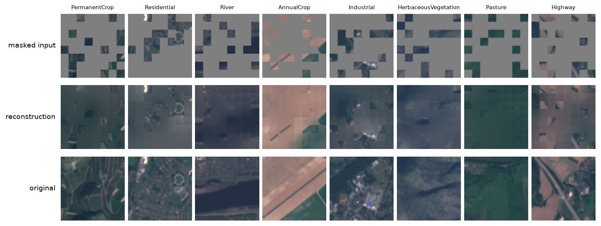
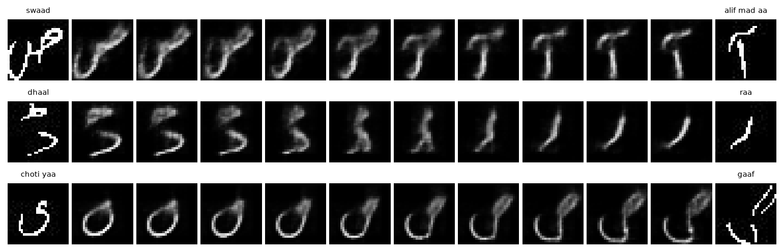
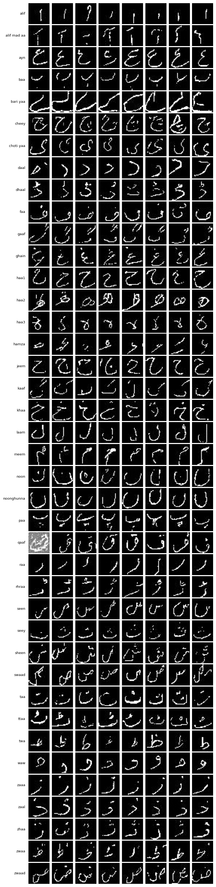
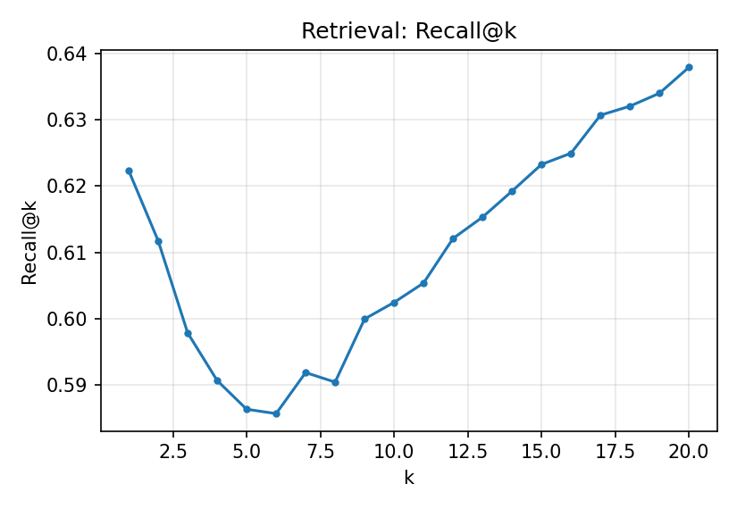

# Four generative models, one app

**MAE · VAE · Diffusion · RAG** — Generative AI, Assignment 04 (Fall 2026)
Author: Muhammad Ahmad (solo submission)

Four generative models built from scratch (or, for RAG, assembled from pretrained parts) and served from one web app:

| Part | What it does | Data |
|---|---|---|
| **A. Masked Autoencoder (MAE)** | Hides 75% of the 8×8 patches of a satellite tile, reconstructs them, and uses the frozen encoder for land-cover classification from only 160 labelled images | EuroSAT RGB |
| **B. Variational Autoencoder (VAE)** | Learns a 16-dimensional latent space of handwritten Urdu characters; reconstructs, samples and interpolates | UHaT |
| **C. Class-conditional diffusion (DDPM)** | Generates a requested Urdu character from pure noise (1000 denoising steps) | UHaT |
| **D. Retrieval-augmented generation (RAG)** | Answers biomedical questions from PubMed abstracts and cites the passages it used | BioASQ (mini) |

## Links

| | |
|---|---|
| Medium blog | TODO |
| LinkedIn post | TODO |
| Trained weights (Hugging Face) | TODO |
| Repository | https://github.com/Ehmad-7/genai_a4_fourgen |

## The app

`uvicorn app.main:app --port 8000` starts a FastAPI app with four tabs, all running the trained models.

| MAE | VAE |
|---|---|
|  |  |
| **Diffusion** | **RAG** |
|  |  |

* **MAE:** pick a test tile → masked input, reconstruction, original, and the predicted land-cover class (top 3 probabilities).
* **VAE:** a button for new random characters, and a slider that moves along the line between the latent means of two chosen characters.
* **Diffusion:** pick a character, get 8 new samples. On a CPU this took about 89 s for 8 samples.
* **RAG:** type a question → answer, the cited passages with their PubMed abstract ids, the other retrieved passages, and a medical notice (research prototype, not medical advice).

## Results

Every number below is produced by a script in this repository and stored in `results/`.

### Table 1: Data

| | |
|---|---|
| EuroSAT train / test images | 16,200 / 5,400 (the 5,400-image validation split is unused) |
| Labelled images used (MAE classifier) | 160 (16 per class, fixed by `few_label_indices`) |
| UHaT character classes | 40 |
| UHaT train / test images | 28,328 / 4,747 |
| BioASQ abstracts | 40,181 |
| Chunks (≤150 words, 30-word overlap) | 79,332 (mean 121.3 words per chunk) |
| BioASQ test questions | 707 |
| Mean number of relevant abstracts per test question | 8.66 |

### Table 2: Training

| Model | Parameters | Final training loss | Time / device |
|---|---|---|---|
| MAE (encoder + decoder) | 3,173,248 | 0.00557 (MSE on masked patches, epoch 100) | 420 s, Tesla T4 (Kaggle) |
| VAE | 220,385 | 130.39 nats (negative ELBO, epoch 30) | 228 s, CPU |
| DDPM U-Net | 4,028,353 | 0.02283 (L_simple, epoch 40) | 2158 s, Tesla T4 (Kaggle) |

The RAG index (79,332 chunk embeddings with `all-MiniLM-L6-v2`) took 188 s on a T4.

### Table 3: Image results

| | |
|---|---|
| MAE few-label classifier, test accuracy (5,400 test tiles) | **54.24%** (same head on a random, untrained encoder: 43.43%; chance: 10%) |
| MAE masked-patch MSE on the test set | 0.00575 (train: 0.00557) |
| VAE test negative ELBO | **130.77 nats** = reconstruction 106.47 + KL 24.30 |
| Diffusion blind test: member 1 correct | **35 / 40** |
| Diffusion blind test: member 2 correct | N/A (solo submission) |
| Diffusion: images where both members agreed | N/A (solo submission) |

### Table 4: Retrieval (707 test questions)

| Hit@1 | Hit@5 | Hit@10 | Recall@1 | Recall@5 | Recall@10 | MRR@10 |
|---|---|---|---|---|---|---|
| 0.6223 | 0.8161 | 0.8614 | 0.6223 | 0.5863 | 0.6024 | 0.7061 |

98 of 707 questions (13.9%) have no relevant abstract in the top 10.

### Table 5: Generation (first 100 test questions)

| | |
|---|---|
| ROUGE-L F1 | 0.2666 (0.2824 over the answers that are not "I don't know") |
| Citation precision | 0.5949 (47 of 79 cited passage numbers point to a chunk of a relevant abstract) |
| "I don't know" rate | 8% |
| Human: answers supported by the passages, member 1 / member 2 | {{RAG_SUPPORTED}} / N/A |
| Human: answers correct, member 1 / member 2 | {{RAG_CORRECT}} / N/A |

Other numbers from the same run: 39 of 100 answers contain no `[n]` citation; for 82 of 100 questions the top-5 chunks contain at least one relevant abstract (Hit@5 over all 707 questions is 0.816, so this is consistent).

### Figures

| Part | Figures |
|---|---|
| MAE | [pretraining loss](results/figures/mae_pretrain_loss.png) · [masked input / reconstruction / original](results/figures/mae_reconstructions.png) · [confusion matrix](results/figures/mae_confusion_matrix.png) |
| VAE | [loss terms per epoch](results/figures/vae_loss_terms.png) · [reconstructions](results/figures/vae_reconstructions.png) · [64 samples](results/figures/vae_samples.png) · [interpolation](results/figures/vae_interpolation.png) |
| Diffusion | [forward noising](results/figures/ddpm_forward_noising.png) · [40 × 8 samples](results/figures/ddpm_samples_grid.png) · [denoising of one sample](results/figures/ddpm_denoising.png) · [training loss](results/figures/ddpm_loss.png) |
| RAG | [Recall@k, k = 1…20](results/figures/rag_recall_at_k.png) |






Qualitative RAG examples (answer, cited passages, reference answer; including a retrieval failure and an "I don't know") are in [`results/samples.md`](results/samples.md); the written analysis is in [`results/analysis.md`](results/analysis.md).

## What was built

**A. MAE** (`part_a_mae/`). Images are cut into 64 patches of 8×8×3. For every image a new random 75% (48 patches) is masked. The encoder (linear patch embedding + learned positional embedding, 6 transformer layers of width 192 with 3 heads and feed-forward width 768, final LayerNorm) sees only the 16 visible patches. The decoder projects to width 128, puts a learned mask token at every masked position, adds positional embeddings, runs 2 transformer layers (4 heads) and predicts the pixels of all 64 patches; the loss is the MSE **on the masked patches only**. Pretraining: AdamW, lr 5e-4, weight decay 0.05, batch 256, 100 epochs, labels unused. Classifier: the encoder is frozen, all 64 patch outputs are averaged to one 192-d vector, and `nn.Linear(192, 10)` is trained on the 160 labelled images (AdamW, lr 1e-3, 200 full-batch steps).

**B. VAE** (`part_b_vae/`). Encoder: two stride-2 convolutions (28→14→7) and two linear layers for μ and log σ² (16-d). Reparameterisation `z = μ + exp(½ log σ²)·ε`. Decoder: linear layer, two transposed convolutions, one logit per pixel (Bernoulli likelihood). Loss = binary cross-entropy summed over the 784 pixels + closed-form KL to N(0, I), averaged over the batch. Adam, lr 1e-3, batch 128, 30 epochs.

**C. Diffusion** (`part_c_diffusion/`). Linear β schedule from 1e-4 to 0.02 over T = 1000 steps. Training predicts the added noise: `L_simple = ‖ε − ε_θ(√ᾱ_t·x₀ + √(1−ᾱ_t)·ε, t, y)‖²` with a class-conditional `diffusers.UNet2DModel` (random initialisation, 40 class embeddings), pixels rescaled to [−1, 1], Adam lr 2e-4, batch 128, 40 epochs. Sampling is the ancestral sampler (Algorithm 2) with σ_t² = β_t and no noise at the last step; the result is clipped to [−1, 1]. Array index t = 0…999 is the step fed to the network (math step t+1).

**D. RAG** (`part_d_rag/`). Abstracts are split into chunks of at most 150 words with a 30-word overlap. Chunks and questions are embedded with `sentence-transformers/all-MiniLM-L6-v2` loaded through `transformers` (mean pooling over real tokens using the attention mask, L2-normalised, truncated at 256 tokens), so cosine similarity is a dot product. An abstract's score is the best score among its chunks. Generation uses the top-5 **chunks** (numbered `[1]`–`[5]`) in a prompt for `Qwen/Qwen2.5-1.5B-Instruct` (chat template, greedy decoding, at most 256 new tokens), told to answer only from the passages, cite passage numbers and say it does not know otherwise.

## Correctness checks

Each part has a `checks.py`; their printed output is saved in `results/*_checks_output.txt`.

| Part | Check | Result |
|---|---|---|
| MAE | exactly 48 of 64 patches masked in every image; loss only on masked patches (changing visible patches does not change the loss) | passed |
| VAE | KL ≥ 0 for 10,000 random posteriors and for posteriors near the prior; KL = 0 at μ = 0, log σ² = 0; closed form equals `torch.distributions.kl_divergence`; reconstruction term equals the BCE formula | passed |
| DDPM | ᾱ_T = 4.036e-5; x₉₉₉ has std 1.000 and correlation 0.0047 with the clean image; the noised image at t = 999 looks like noise (`ddpm_forward_noising.png`) | passed |
| RAG | every chunk ≤ 150 words (max 150); consecutive chunks share exactly 30 words (31,119 abstracts have more than one chunk); every embedding has norm 1 (min and max 1.000000); a text gives the same embedding alone or padded in a batch (max difference ~1e-7); a perfect retriever gives Hit@k = Recall@k = MRR@10 = 1 | passed |

## Human evaluation (solo)

* **Diffusion blind test.** `part_c_diffusion/sample.py --blind` generates one sample of each of the 40 characters, shuffles them and hides the labels; the labels were only opened after all 40 guesses were written to `results/blind_test/guesses.csv`. Because every character appears exactly once, elimination was possible. The reported result comes from the second sheet (`--seed 1`): 35 / 40. The five mistakes are one swap (`noon` ↔ `noonghunna`) and a three-way shift among `ttaa`, `daal` and `sheen`. Scoring: `part_c_diffusion/score_blind.py` → `results/human_eval.csv`.
* **RAG answers.** 20 of the 100 answers (fixed seed) were read against their five passages (`results/rag_human_eval_sheet.md`) and labelled 1/0 for *supported* (everything the answer says is in the passages) and *correct* (agrees with the reference answer) in `results/rag_human_labels.csv`; `part_d_rag/score_human_rag.py` merges them into `results/human_eval.csv`.
* There is no second member, so every member-2 column and the "both agreed" count are `NA`.

## Notes and limitations

* **MAE classifier:** the head is trained exactly as specified (200 full-batch steps). Its training accuracy is only 63% and its loss is still falling, so 54.24% is a conservative number for this protocol. The comparison with a random encoder (43.43%) shows what pretraining adds (+10.8 points).
* **Architecture details the assignment left open:** MAE and VAE use no dropout; the MAE transformer layers are pre-LayerNorm with GELU; the VAE decoder has no ReLU after its first linear layer (none is listed in the specification).
* **Diffusion** has no EMA and no test loss, as specified; sample quality was judged by eye and by the blind test.
* **Retrieval** failures are partly a data problem: for the first failed question the labelled "relevant" abstract starts with a conflict-of-interest statement, so no text-based retriever can match it to the question.
* **Generation:** citation precision mixes retrieval quality and citation behaviour (if no relevant chunk is in the top 5, every citation counts as wrong even when the answer is faithful to the retrieved text). ROUGE-L is computed on the answer with `[n]` markers removed. Citation precision counts the distinct passage numbers cited per answer. The "I don't know" detector is a regular expression, so `part_d_rag/analyze_answers.py` lists every flagged answer for a manual check. When no relevant abstract was in the context (18 of 100 questions) the model still answered 11 times.
* **Medical notice:** the RAG tab is a research prototype. Its answers can be wrong or unsupported and must not be used for medical decisions.

## Repository layout

```
starter/            the given data loaders and check_starter.py (unchanged)
part_a_mae/         model.py, pretrain.py, reconstruct.py, classify.py, checks.py
part_b_vae/         model.py, train.py, visualize.py, checks.py
part_c_diffusion/   schedule.py, model.py, train.py, sampler.py, sample.py, score_blind.py, checks.py
part_d_rag/         chunking.py, index.py, search.py, metrics.py, evaluate.py, generate.py,
                    analyze_answers.py, score_human_rag.py, checks.py
results/            figures/, screenshots/, rag_answers.jsonl, human_eval.csv, analysis.md, samples.md, logs and tables
app/                main.py (FastAPI), loader.py, static/ (index.html, app.js, style.css)
scripts/            helper scripts (data_stats.py, fill_readme.py)
weights/            trained weights (not committed; see below)
```

## Reproducing everything

### Environment

```bash
git clone https://github.com/Ehmad-7/genai_a4_fourgen.git
cd genai_a4_fourgen
python3 -m venv .venv && source .venv/bin/activate
pip install torch --index-url https://download.pytorch.org/whl/cpu   # or the default (CUDA) build
pip install -r requirements.txt
```

### Data

EuroSAT and BioASQ download automatically from Hugging Face on first use. UHaT:

```bash
mkdir -p starter/data/uhat && cd starter/data/uhat
wget -O data.zip "https://zenodo.org/records/3670611/files/data.zip?download=1"
unzip -q data.zip && rm data.zip && cd ../../..
cd starter && python check_starter.py && cd ..      # Task 0: loaders and example grids
```

### Training and evaluation

All scripts run from the repository root. The GPU steps were run on Kaggle (Tesla T4, internet on): clone the repo, `pip install -q diffusers`, download UHaT as above, run the command, and zip `weights/` and `results/` to download them.

| Part | Commands | Where |
|---|---|---|
| A | `python part_a_mae/checks.py` · `python part_a_mae/pretrain.py` · `python part_a_mae/reconstruct.py` · `python part_a_mae/classify.py` | pretraining on GPU (7 min); the rest on CPU |
| B | `python part_b_vae/checks.py` · `python part_b_vae/train.py` · `python part_b_vae/visualize.py` | CPU (about 4 min) |
| C | `python part_c_diffusion/checks.py` · `python part_c_diffusion/train.py` · `python part_c_diffusion/sample.py` · `python part_c_diffusion/sample.py --blind --seed 1` · `python part_c_diffusion/score_blind.py` | training and sampling on GPU (36 min training) |
| D | `python part_d_rag/index.py` · `python part_d_rag/checks.py` · `python part_d_rag/evaluate.py` · `python part_d_rag/generate.py` · `python part_d_rag/analyze_answers.py` · `python part_d_rag/score_human_rag.py` | index and generation on GPU (index 3 min); the rest on CPU |

Every training script accepts `--limit N` (a few images; outputs get a `smoke_` prefix) for a quick end-to-end test. Training seed is 42 in all three models.

### Trained weights

Weights are not committed. Download them from the Hugging Face repository linked at the top and put them in `weights/`:

```
weights/mae.pt                  MAE encoder + decoder
weights/mae_classifier.pt       linear head trained on 160 labelled tiles
weights/vae.pt                  VAE
weights/ddpm.pt                 class-conditional U-Net
weights/rag_index.npy           79,332 chunk embeddings (or rebuild with part_d_rag/index.py)
weights/rag_chunk_doc_ids.npy   abstract id of every chunk
```

The two RAG language models (`sentence-transformers/all-MiniLM-L6-v2`, `Qwen/Qwen2.5-1.5B-Instruct`) are downloaded automatically from Hugging Face.

### Running the app

```bash
source .venv/bin/activate
uvicorn app.main:app --port 8000        # then open http://127.0.0.1:8000
```

The first RAG question downloads Qwen2.5-1.5B (about 3 GB) and loads it in float32 on a CPU (float16 on a GPU), so it needs several GB of RAM and a CPU answer can take minutes. The diffusion tab runs 1000 denoising steps per request.

## Data and models used

* EuroSAT RGB: `blanchon/EuroSAT_RGB` (Hugging Face)
* UHaT handwritten Urdu characters: Zenodo record 3670611
* BioASQ mini: `enelpol/rag-mini-bioasq` (Hugging Face)
* Retriever: `sentence-transformers/all-MiniLM-L6-v2`; generator: `Qwen/Qwen2.5-1.5B-Instruct`
* U-Net: `diffusers.UNet2DModel`
